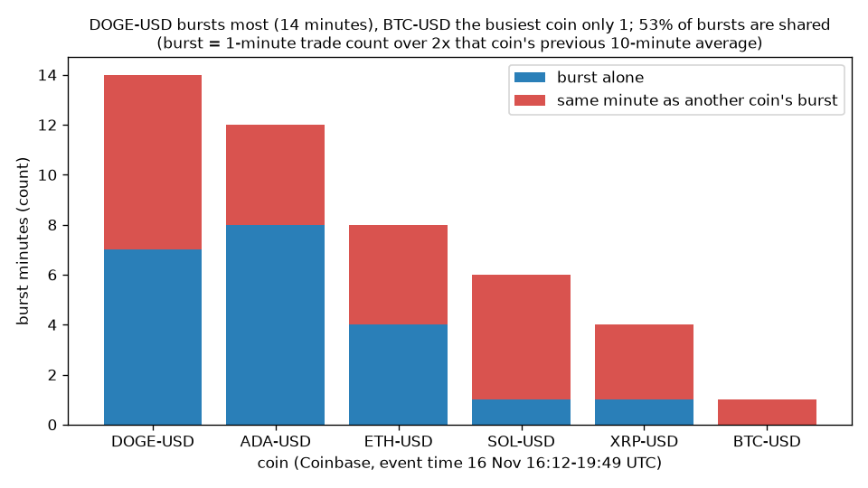

# Do crypto trade bursts move together? Coinbase trades through Kafka

Author: Musayab Razaq
DS 3022 Data Project 3, Fall 2026

## Data source

I streamed live trades from the Coinbase Exchange websocket (wss://ws-feed.exchange.coinbase.com) on the matches channel for BTC-USD, ETH-USD, SOL-USD, XRP-USD, DOGE-USD and ADA-USD, it is a push source so one connection stays open and every single trade shows up as a match message with a trade_id, product_id, side, price, size, sequence and time. There is no key or account, the only rule is that you have to send the subscribe message within 5 seconds or Coinbase hangs up on you, and the first messages you get back are not even trades, it is one subscriptions reply and then a last_match per coin which is basically Coinbase telling you the last thing that happened before you showed up. There is no replay at all so everything here was caught live on Mon 16 Nov 2026 from about 16:12 to 19:49 UTC, which was the evening for me in Valencia but late morning and early afternoon on the US east coast, and I think that is why my probe measured 35.47 trades a second when the class slides from 05 Nov had 5.7.

## How to run

From a fresh clone on a Mac (on Windows activate with .venv\Scripts\Activate.ps1):

```bash
git clone https://github.com/MusayabR/ds3022-streaming.git
cd ds3022-streaming
python3 -m venv .venv
source .venv/bin/activate
pip install -r requirements.txt
pip install prefect matplotlib
docker compose up -d
docker exec -it redpanda-0 rpk cluster info
docker exec -it redpanda-0 rpk topic create coinbase_trades -p 3 -r 3
cd project3
python flow.py data/sample
```

That last line runs on the committed sample and does not need Kafka at all. To collect the real thing use one terminal for each:

```bash
python producer.py
python lander.py
python flow.py
```

For the Prefect dashboard run prefect config set PREFECT_API_URL=http://127.0.0.1:4200/api and then prefect server start in another terminal and open http://127.0.0.1:4200. If the producer dies with CERTIFICATE_VERIFY_FAILED on a Mac, run export SSL_CERT_FILE=$(python -m certifi) in that terminal first, this got me before I sent a single message.

## Architecture

```
Coinbase websocket (matches, 6 coins)
  -> producer.py (envelope {"action": "live", "data": ...}, key = product_id)
  -> Kafka topic coinbase_trades (Redpanda, 3 brokers, 3 partitions, 3 replicas)
  -> lander.py (group coinbase_trades_lander, file per 1,000 records or 60 s, .tmp then rename, offsets after the file)
  -> data/raw/coinbase_<time>_<id>.parquet (285,989 rows) and data/sample/sample.parquet (5,000 rows)
  -> flow.py (Prefect flow coinbase-pipeline, DuckDB coinbase.duckdb)
       load_raw -> raw_trades
       stage    -> stg_records (one copy per Kafka record, no malformed, only match messages)
       entities -> trades (one row per product_id + trade_id, event_time as a UTC timestamp)
       marts    -> mart_minute_bursts, mart_bursts_by_coin
       chart    -> charts/bursts_by_coin.png
```

The screenshots are in docs, topic.png is the Console with the 3 partitions, flow_log.png is the flow log with the four numbers and prefect_dashboard.png is the completed run happy-cuttlefish with all five tasks green.

## Design decisions

1. Key and partitions. I keyed by product_id because my whole question is about each coin's own rhythm minute by minute, and if a coin's trades got scattered across partitions I would be rebuilding its timeline out of order, the catch is that hashing six keys onto three partitions is lopsided and mine ended at 211,159 on partition 0 against 17,281 on partition 1 and 56,471 on partition 2, so partition 0 was doing about three quarters of the work. If I had keyed by trade_id the partitions would look nice and even but that evenness would be fake, it would just mean every coin is chopped up across all three.

2. Batch size and time. Files close at 1,000 records or 60 seconds, and at the 30 to 40 trades a second I was getting the 1,000 rule wins basically every time, a file every 25 to 35 seconds or about 100 to 140 files an hour, so the 60 second rule was really only a cleanup crew that showed up when I stopped the producer and closed the leftovers like the 986, 78 and 67 record files.

3. Offsets after the file. If the lander dies between writing a file and storing the offsets, Kafka never heard that those records were done so it serves them again and they land twice, and I would much rather have that than the other order where the offsets say done but the file never got written and the records are just gone. My laptop actually tested this for me without asking, it slept for an hour, Kafka waited 122,189 ms for the lander to check in, gave its partitions away, and when the Mac woke up the lander wrote a 78 record file and then crashed trying to store offsets it no longer owned, and those 78 just came back as copies.

4. Duplicates. The same Kafka record means the same kafka_partition and kafka_offset, which only happens when the lander re-lands a batch, and stage() kills those with SELECT DISTINCT * EXCLUDE (landed_at) since landed_at is the only column that is different between the two copies. The same trade means the same product_id and trade_id and entities() keeps one with QUALIFY row_number() OVER (PARTITION BY product_id, trade_id ORDER BY kafka_offset DESC) = 1, but on Coinbase a trade is final the second it happens so there is never a newer version to prefer, the only way the same trade shows up twice is a last_match after a reconnect repeating a trade I already had, and since the stage already throws out last_match the entity step ends up with nothing to remove, which is why both counts are 284,868.

5. Windows and time. Everything is on event time, the Coinbase time field cast to a UTC timestamp, because landed_at would lie, it has a whole hour of nothing from when my laptop slept and then a wall of rows when the lander caught up, and none of that was the market. I went with 1 minute tumbling windows because a burst in crypto is a matter of seconds and a 1 hour window would just average it away, and each minute is judged against that same coin's previous 10 minutes so DOGE is compared to DOGE and not to BTC.

6. Ten times the volume. At around 350 trades a second the lander would be closing a file every 3 seconds, so something like 1,200 tiny parquet files an hour, and the flow reads every single file and rebuilds every table from zero on each run, so it would get slower every hour without anything going wrong. The real wall though is partition 0, ten times the BTC and friends traffic still all hashes to one partition on one leader, so adding partitions would do nothing, I would need bigger batches like 10,000, a job that compacts old files, a flow that only reads new files, and probably a key that spreads the hot coins out if I could live without strict per coin order.

## Chaos round

The four numbers are raw records, malformed, unique Kafka records and unique trades, from python four_numbers.py product_id,trade_id.

| Card | Prediction | What I did | Numbers before -> after | Explanation |
|---|---|---|---|---|
| D1 Crash between file and offsets | Raw goes up by the new records N plus 1,000 because the crashed batch lands twice, unique records and unique trades go up by N only, malformed stays 0 | Stopped the lander and ran python producer.py, which I meant to run for 2 minutes and then forgot about until 20:39 so N ended up being 215,986, ran python lander.py crash which wrote one file of 1,000 and died on purpose, then python lander.py. In the middle of all this my laptop slept from 18:25 to 19:24 and the lander crashed for real with StoreOffsets failed right after writing a 78 record file, so I restarted it | raw 61,712 -> 278,776, malformed 0 -> 0, unique records 61,712 -> 277,698, unique trades 61,711 -> 277,693 | Raw went up by N + 1,078 instead of N + 1,000, and the extra 78 is the batch from the sleep crash, so I got one planned crash and one unplanned one and both behaved the same way, the batch landed twice and nothing was lost. That is at-least-once, offsets are stored only after the file exists, and DISTINCT on partition and offset makes the copies harmless |
| D2 Poison message | The lander keeps running, raw and malformed go up by 1, unique records and trades stay the same | Ran docker exec -it redpanda-0 rpk topic produce coinbase_trades -k bad, typed this is not JSON, pressed Ctrl+C and rpk said it landed at partition 1 offset 17018, waited for the next Landed line and counted | raw 282,457 -> 283,100, malformed 0 -> 1, unique records 281,379 -> 282,021, unique trades 281,374 -> 282,016 | Malformed moved by exactly 1 and the lander never blinked, to_row() caught the JSON error and landed the text with action = malformed. The other 642 were real trades from the producer's last batch that were still sitting in memory waiting for the 60 second rule when I took my before count, so that was my timing and not the poison message. If the lander had crashed instead it would hit offset 17018 again on every restart and partition 1 would be stuck there forever |
| D3 A broker goes down | Producer and lander keep running maybe with some warnings, raw and unique records go up by the same amount, malformed stays 1 | Started python producer.py with the lander running, ran docker stop redpanda-1, the producer complained Connect to 29092 failed: Connection refused and then just kept sending, ran docker start redpanda-1, checked rpk cluster info until all 3 brokers were back, stopped the producer and counted | raw 283,100 -> 285,989, malformed 1 -> 1, unique records 282,021 -> 284,910, unique trades 282,016 -> 284,904 | Raw and unique records both went up by the same 2,889 so nothing got lost or doubled, and the topic total 211,159 + 17,281 + 56,471 = 284,911 is exactly my unique records plus the one poison message. You can see the failover in rpk too, partition 0 changed leader and its epoch went up to 5, because with replication factor 3 the other two brokers just took over the partitions broker 1 was leading and 2 out of 3 was enough to keep writing |

## The four numbers

From the flow log on the full data (docs/flow_log.png), two runs in a row with the same numbers both times.

| Number | Full data | Sample (data/sample) |
|---|---:|---:|
| Raw records landed | 285,989 | 5,000 |
| Malformed (kept in raw) | 1 | 0 |
| Unique Kafka records | 284,868 | 4,999 |
| Unique trades (product_id + trade_id) | 284,868 | 4,999 |

Unique Kafka records here is 42 lower than four_numbers.py gave me (284,910) because the flow's stage also throws out the subscriptions and last_match messages that show up every time the producer connects, they are Coinbase saying hello and not new trades. The sample has 0 malformed because my one poison message just did not get picked in the random 5,000.

## Challenges / Obstacles

The first wall was before Kafka was even involved, the probe could not connect at all and failed with CERTIFICATE_VERIFY_FAILED, it turns out Python from python.org on a Mac does not use the Mac's own certificates, and the Install Certificates script did not fix it for me so I pointed SSL_CERT_FILE at certifi and saved that in my zshrc so every new terminal had it. I also nearly ran the producer before creating the topic, which would have let Redpanda make it by itself with one partition and ruined the key design before it started. The laptop sleeping in the middle of the chaos round was the most stressful part but honestly the most useful, it showed me a real consumer group timeout and a real at-least-once recovery that I did not plan, and after that I kept caffeinate -dims running. For the analysis I first used a 3 times threshold and BTC-USD came out with zero bursts which looked like a bug, so instead of guessing I queried the ratio of every minute to its trailing average per coin and found BTC's 99th percentile was only 2.27 and its biggest jump fell in its first 10 minutes where there is no history to compare to, so the code was right and BTC just never tripled, and I moved the threshold to 2 times.

## Analysis

I wanted to know which coins actually have trade bursts, a 1 minute trade count more than 2 times that coin's own average over the previous 10 minutes, and whether those bursts happen alone or hit several coins in the same minute. Over about 3.5 hours of event time there were 45 burst minutes, DOGE-USD had 14, ADA-USD 12, ETH-USD 8, SOL-USD 6, XRP-USD 4 and BTC-USD had exactly 1, and 53% of all of them landed in the same minute as some other coin's burst. The part I did not expect is that BTC-USD, which has more trades than any of the others, is the calmest one, it trades so constantly that doubling in a minute almost never happens, while DOGE and ADA which are much thinner markets spike over and over, so the coin with the most activity is the one with the least drama. The big limitation is that this is one evening with holes in it, the producer was off for the chaos cards and my laptop slept from 17:25 to 18:24 UTC, and I picked the 2 times threshold after already seeing the data, and with bursts this common some of that 53% could just be two coins spiking by chance in the same minute and not one shared market move.

## Plot / Visualization



## Reflection

Before 22 Oct I thought of data as a file you download and then work with, and this project kind of broke that for me because a stream is never done and never clean, records come twice, come broken, or stop coming because your laptop lid closed. What surprised me most is that the thing protecting all of it is one boring line order in the lander, write the file and then store the offsets, and that line is the reason a crash, a poison message and a sleeping laptop all ended up as duplicates instead of holes. I also stopped trusting logs as proof and started trusting arithmetic, adding three high watermarks and getting the exact same number as my unique records plus one is what actually convinced me nothing was lost when I killed a broker. If I did it again I would start collecting the evening of Session 1, keep my laptop plugged in and awake from minute one, and look at the per coin ratios before choosing a burst threshold instead of after the chart came out empty.

## Acknowledgements

The producer, lander and flow are adapted from the class scripts (quakes_producer.py, quakes_lander.py and quakes_flow.py from Mon 02 Nov), the websocket connection and reconnect loop follow probe.py and the Session 1 worksheet, and SCHEMA, to_row(), stage(), entities() and four_numbers.py follow the Coinbase parts of the Session 2 and 3 worksheets. The AI drafted the producer, lander and flow changes, the burst mart and a draft of this README from my own numbers, and I checked everything by running each step myself, the raw count matched the topic total, the chaos card numbers matched the predictions, two flow runs gave the same four numbers and I checked the threshold against the per coin ratios before changing it.

## AI was used to assist and walk through some parts of this project, it was also used to interpret parts that were ambiguous, it also helped with trouble shooting.
